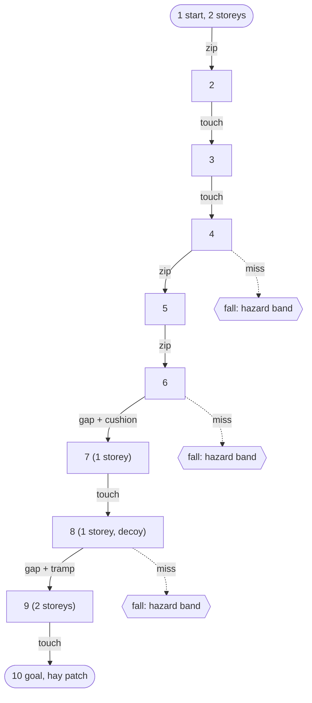

# Valley Run (valley-1) level graph

Source: `content/graphs/valley-1.graph.json`, placed by `src/content/graph/place.ts` (seed 20261113).
Mermaid drawing of the graph (ADR 0013 section 3). Edge labels are the edge kind; node 8 is a decoy
host. Success path is the single chain 1 to 10; failure is a fall to the hazard band below each hop.

Screenshots (390x844 portrait, Low tier): `docs/img/t313-valley-top.png` (spawn),
`docs/img/t313-valley-bottom.png` (start moved to node 9 for the shot), `docs/img/t313-lobby.png`
(five lobby entries).
