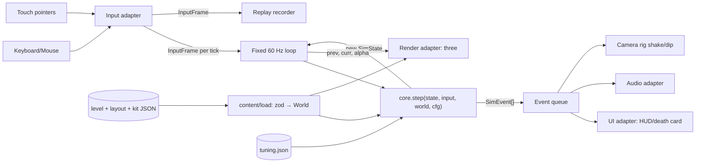
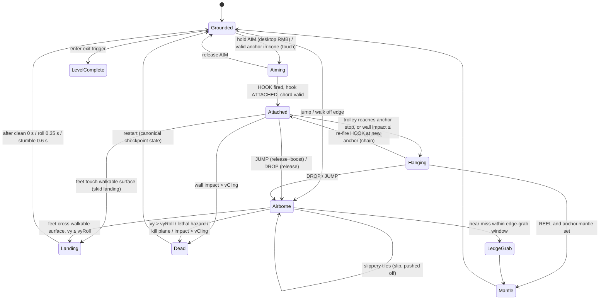
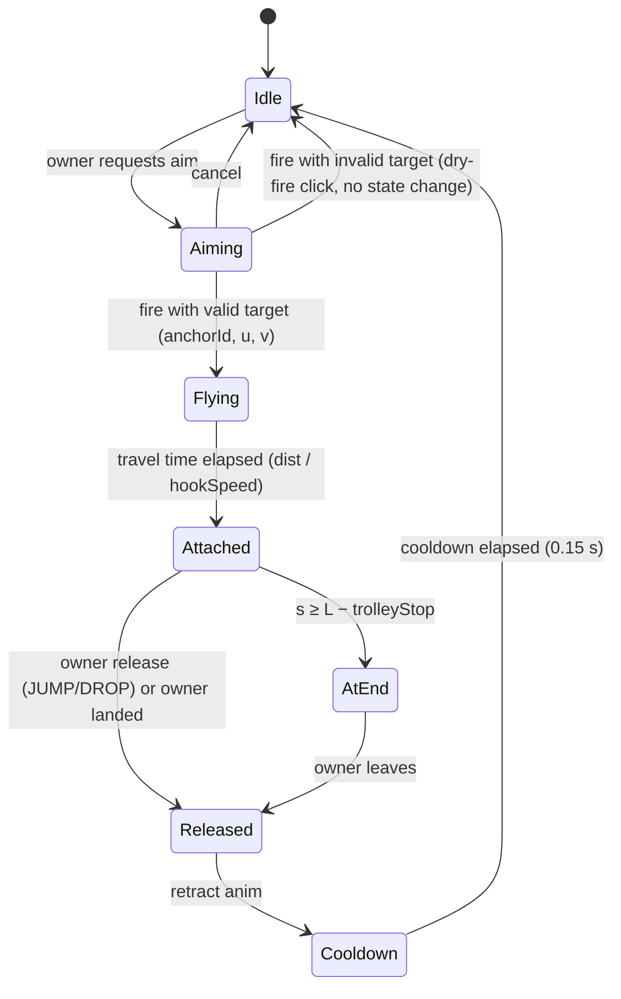

# ZIPLINE TOLE: Plan and Architecture (MVP0 → MVP1 → Godot)

> Third-person, single-player web game. You fire a zipline hook at marked anchors and slide from house to house down a Kathmandu-valley hillside at golden hour, picking the one or few correct ways onto each roof. Bad landings kill you. Restart is instant.
>
> Working title: _Zipline Tole_ (_tole_ is a Newari neighbourhood). Doc owner: lead architect. Status: v1 plan, 2026-11-05.
>
> Changelog: 2026-11-05: applied senior review (ADR 0001). See `docs/adr/0001-feel-model.md` and `docs/work-breakdown.md`.

---

## 0. TL;DR decisions

> **Locked by the user (2026-11-05):** one-hit death (no pips; any wall impact above `vCling` kills) · preview help fades out by L1c · neutral parkour-runner hero · `*.pages.dev` hosting. Feel model (rope defaults, hand-brake, momentum carry, touch scheme): see ADR 0001. Any remaining mention of pips is a superseded note.

| Area             | Decision                                                                                                                                                                    |
| ---------------- | --------------------------------------------------------------------------------------------------------------------------------------------------------------------------- |
| Renderer         | **three.js `WebGLRenderer`**, exact version pinned. Stock materials only, no custom shaders, no post-processing.                                                            |
| Language/tooling | **TypeScript (strict) + Vite + pnpm + Vitest**. Vanilla DOM for the UI, no framework.                                                                                       |
| Core             | **Pure-TS deterministic sim** with no three/DOM imports. Runs at a fixed 60 Hz. `step(state, input, world, cfg)` works like a Bloc reducer.                                 |
| Physics          | **Custom kinematic code, no physics engine.** The rope is a straight chord. Collisions are against axis-aligned boxes (AABBs). Landing and impact are speed/angle rules.    |
| Level format     | **JSON** (layout + level files) validated with **zod**. JSON is the gameplay source of truth. GLB files are visuals only.                                                   |
| No-dead-end rule | Enforced by a **validator CLI** that uses the real core sim. Runs in CI (CLI) and blocks deploys; a dev-time watcher is optional.                                           |
| Assets           | One **kit GLB per theme** with named `part_*` nodes. Any part that is missing falls back to a procedural primitive. Art swap means dropping in a file, with no code change. |
| Input            | **Pointer Events**. Desktop: pointer lock + WASD + mouse. Touch: floating stick + look-drag + buttons. Both from day 1.                                                     |
| Hosting          | **Cloudflare Pages** via GitHub Actions, with preview deploy per branch. Deploy from M0 onward.                                                                             |
| Godot            | Later **native** target, written in **GDScript**. Ported with golden input traces. The zipline later becomes a self-contained `ZiplineAbility` node for the shooter.        |

---

## 1. Vision, pillars, scope

**Pillars**

1. **Read the roof, pick the line.** Anchors and roof layout _are_ the mechanic. Every outcome is predictable from geometry.
2. **Commit and release.** Skill means choosing aim height and release timing. Speed pays off, and so does a clean landing.
3. **Fair, instant failure.** Every death has a visible cause and a one-line explanation. You are back in under 1 s.
4. **Golden-hour Kathmandu.** Dense Newari brick and modern concrete houses step down a hazy valley at sunset.
5. **Never a dead end.** If you are alive, a way down exists. This is a hard, machine-checked rule.

**Scope split**

| MVP0 (ship first)                                                                                                            | MVP1 (backlog)                                                                 | Later                                             |
| ---------------------------------------------------------------------------------------------------------------------------- | ------------------------------------------------------------------------------ | ------------------------------------------------- |
| One Newari hill layout reused for **3 short descents** (L1a teach, L1b decoys/release, L1c full chained route), 20–60 s each | **Melee combat** on balconies and roofs, including a "zip-kick" arrival attack | Godot 4 native port; zipline as a shooter ability |
| Hook: free aim at marked anchors, slide, release/jump, hang, reel/mantle                                                     | 2–3 more levels, new themes (kit swap)                                         | Level editor (in-browser)                         |
| Landing / wall impact / fall rules, one-hit death (wall impact above `vCling` is lethal)                                     | Ghost of best run; share-a-run URL                                             | Online leaderboards (Workers + KV/D1)             |
| Aim preview (green/yellow/red), death cause line, instant checkpoint restart                                                 | Audio pass and music                                                           | Moving and swinging anchors, mid-air re-hook      |
| Sunset sky, fog, layered ridgelines, primitive/basic kit art                                                                 | Hazards: live power wires, crumbling parapets                                  | Ragdolls (Rapier) if ever needed                  |
| Desktop + touch, quality presets, static hosting, level validator in CI                                                      | Time-trial medals UI polish, accessibility options                             |                                                   |

Because all three descents share one hill geometry, they are nearly free to make. Each one only needs its own spawn, exit, route and tutorial data.

---

## 2. Key decisions (with Godot-port impact)

| #   | Decision                                                                                                                                                                         | Why                                                                                                                                                                             | Alternatives rejected                                                                                     | Godot-port impact                                                                                    |
| --- | -------------------------------------------------------------------------------------------------------------------------------------------------------------------------------- | ------------------------------------------------------------------------------------------------------------------------------------------------------------------------------- | --------------------------------------------------------------------------------------------------------- | ---------------------------------------------------------------------------------------------------- |
| D1  | three.js **WebGLRenderer**, pinned exactly (e.g. `"three": "0.18x.0"`, see Verify list)                                                                                          | Mature on mobile Safari and Chrome. `WebGPURenderer` is still marked experimental, its WebGL2 fallback lacks features, and `ShaderMaterial`/`onBeforeCompile` don't work there. | Babylon (heavier), PlayCanvas (editor lock-in), Godot web export (8–12 MB WASM [unverified], weak on iOS) | None. The render adapter is rewritten anyway; it is thin.                                            |
| D2  | **TypeScript strict**, Vite, no UI framework                                                                                                                                     | You know TS. Fastest iteration. A tiny HUD needs no React.                                                                                                                      | Dart/Flutter web (poor 3D story)                                                                          | The core is written in a "GDScript-shaped" TS subset (§6.3), so the port is mechanical.              |
| D3  | **Custom kinematic core.** Straight-chord rope, AABB world, geometric rules                                                                                                      | Deterministic, replayable and predictable for players. Trivial to port. No WASM init.                                                                                           | Rapier (1–2 MB WASM, async init, no Godot equivalent), cannon-es (unmaintained feel)                      | High portability. The same math becomes GDScript and behaves identically, verified by golden traces. |
| D4  | World restricted to **AABBs** (house yaw ∈ {0,90,180,270})                                                                                                                       | Collision, sweeps and validator sampling stay trivial and robust.                                                                                                               | OBB / mesh colliders                                                                                      | Godot uses `BoxShape3D` only for editor visualization; the math stays in script.                     |
| D5  | **JSON levels + zod**. Kit archetypes describe gameplay geometry, and levels place archetypes.                                                                                   | Hand-authorable, diffable, CI-validated. Godot's `JSON.parse_string` reads the same files.                                                                                      | Gameplay data in glTF extras/empties (fragile import path [unverified]), Tiled maps                       | **Fully portable** (same files). A GDScript loader (~300 LOC) is needed.                             |
| D6  | **Assets:** a GLB kit per theme, `part_*` nodes, procedural fallback. Source GLB uncompressed, web build compressed with gltf-transform (meshopt + KTX2)                         | Art can be swapped without code. Godot imports the uncompressed source.                                                                                                         | Per-house unique meshes (draw calls, no reuse)                                                            | Godot uses the **source** GLBs and builds `MultiMeshInstance3D` per part.                            |
| D7  | **Pointer Events** with per-pointer tracking and `setPointerCapture`, plus an engine-agnostic `InputFrame`                                                                       | One code path for mouse, touch and pen. Recorded frames give replays and tests.                                                                                                 | Separate touch/mouse libs                                                                                 | Action names are mirrored in the Godot `InputMap`. `InputFrame` is identical.                        |
| D8  | **Cloudflare Pages** with GitHub Actions                                                                                                                                         | Free, custom `_headers`, preview URLs, fast globally (including NP/IN). No SharedArrayBuffer needed.                                                                            | Netlify (equally fine; use it if you already have it), itch.io (later mirror)                             | N/A                                                                                                  |
| D9  | Restart = **reset sim state to a checkpoint snapshot** (plain-data clone). No reloads.                                                                                           | Sub-second restart. It falls out naturally from plain-data state.                                                                                                               | Scene reload                                                                                              | Same pattern in Godot (`state.duplicate()`).                                                         |
| D10 | **Locked: one-hit death.** No health pips. Wall impact above `vCling` kills; below it you cling harmlessly. Bad landings either kill or are a harmless stumble (time cost only). | Simple, readable, high-stakes; instant restart makes it fair.                                                                                                                   | 3 pips, numeric HP                                                                                        | Becomes damage amounts sent to the shooter's health component later (§6.5).                          |

---

## 3. Architecture

### 3.1 Repository layout

```
zipline-tole/
├─ src/
│  ├─ core/                 # PURE TS. No three, no DOM, no async. Compiled with tsconfig.core.json (lib: ES2022 only)
│  │  ├─ math/vec3.ts       # Vec3 class with plain fields + free functions (add, sub, scale, dot, ...)
│  │  ├─ math/aabb.ts       # AABB, segment-vs-AABB, swept capsule (vertical segment + radius) vs AABB
│  │  ├─ rng.ts             # seeded mulberry32 (cosmetic variation only)
│  │  ├─ config.ts          # Tuning type + defaults (mirrors content/config/tuning.json)
│  │  ├─ world.ts           # runtime World: flat arrays of solids, surfaces, hazards, anchors, triggers (int ids)
│  │  ├─ input.ts           # InputFrame + button bit flags
│  │  ├─ hook.ts            # Hook state machine (self-contained unit)
│  │  ├─ rope.ts            # chord math: validity, slide integration, body sweep
│  │  ├─ hero.ts            # Hero state machine, walking controller, airborne/landing
│  │  ├─ rules.ts           # landing / wall-impact / fall classification (pure functions)
│  │  ├─ aim.ts             # anchor magnetism + snap + preview prediction (calls rope/rules)
│  │  ├─ sim.ts             # SimState, step(), events, checkpoint snapshot/restore
│  │  └─ replay.ts          # InputTrace record/playback, state hash
│  ├─ content/              # loaders: zod schemas → World (expansion of archetypes into world space)
│  │  ├─ schema.ts
│  │  └─ load.ts
│  ├─ adapters/
│  │  ├─ render/            # three.js: scene, instancing, kit loader, sky, hero view, rope view, camera rig
│  │  ├─ input/             # keyboard+mouse, pointer lock, touch stick/buttons → InputFrame
│  │  ├─ audio/             # WebAudio SFX, unlock-on-first-gesture
│  │  └─ ui/                # DOM HUD, death card, menus, debug HUD (lil-gui under ?debug)
│  ├─ app/
│  │  ├─ loop.ts            # fixed-timestep loop + interpolation
│  │  ├─ game.ts            # wires core ↔ adapters, level flow, save (localStorage)
│  │  └─ main.ts
├─ content/
│  ├─ config/tuning.json
│  ├─ kits/newari/{kit.json, archetypes.json, palette.json, parts.json}
│  ├─ hills/kirtipur_01.layout.json
│  └─ levels/{l1a.json, l1b.json, l1c.json}
├─ assets-src/              # UNCOMPRESSED source GLB/PNG (Godot uses these)
├─ public/assets/           # build output: compressed GLB (meshopt/KTX2), hashed
├─ tools/
│  ├─ validate-levels.ts    # CLI: schema + geometry + route graph + no-dead-end (§3.7)
│  ├─ run-golden.ts         # replays tests/golden/*.trace.json headless
│  ├─ kit-check.ts          # checks kit GLB node names/scale/pivots vs parts.json
│  └─ build-assets.ts       # gltf-transform optimize (meshopt + KTX2)
├─ tests/{core/*.test.ts, golden/*.trace.json, levels/fixtures/*.json}
└─ .github/workflows/ci.yml # lint → typecheck → test → validate → golden → build → deploy
```

**Purity enforcement.** `tsconfig.core.json` sets `"lib": ["ES2022"]` with no DOM, so `window` and `document` fail to compile. ESLint `no-restricted-imports` bans `three` and `src/adapters/*` inside `src/core`.

### 3.2 Data flow



Adapters **read** the sim state and events but never mutate them. The only path into the core is an `InputFrame`.

### 3.3 Core interfaces (illustrative)

```ts
// core/input.ts
export const BTN_JUMP = 1,
  BTN_HOOK = 2,
  BTN_DROP = 4,
  BTN_REEL = 8,
  BTN_AIM = 16,
  BTN_RESTART = 32,
  BTN_ATTACK = 64; // ATTACK reserved for MVP1
export class InputFrame {
  moveX = 0;
  moveY = 0; // -1..1 (camera-relative, adapter resolves)
  camYaw = 0;
  camPitch = 0; // radians: camera orientation, used for aim ray & move basis
  buttons = 0; // held bits
  pressed = 0; // edge bits this tick (adapter computes)
}

// core/sim.ts
export class SimState {
  tick = 0;
  hero = new Hero();
  hook = new Hook();
  deaths = 0;
  checkpoint = -1;
  done = false;
}
export function step(s: SimState, inp: InputFrame, w: World, cfg: Tuning, out: SimEvent[]): void; // mutates s, appends events
export function snapshot(s: SimState): SimState; // plain-data deep copy (checkpoint/restart)
```

`SimEvent` is a plain class `{ kind: EventKind (int enum), a: number, b: number, pos: Vec3 }`. Example: `IMPACT`, a = speed, b = surface id.

### 3.4 Fixed-timestep loop

```ts
const DT = 1 / 60;
let acc = 0;
function frame(nowMs: number) {
  acc += Math.min((nowMs - last) / 1000, 0.25);
  last = nowMs;
  let n = 0;
  while (acc >= DT && n < 5) {
    copyInto(prev, curr);
    input.sample(frameIn);
    step(curr, frameIn, world, cfg, events);
    acc -= DT;
    n++;
  }
  render.draw(prev, curr, acc / DT);
  ui.consume(events);
  audio.consume(events);
  events.length = 0;
  requestAnimationFrame(frame);
}
```

- Simulation time is measured in **ticks**, which are also used for scoring. Wall-clock time is never used in the core.
- When the tab is hidden, the loop pauses and the accumulator resets.
- Slow-mo (an optional assist) scales how much real time feeds the accumulator. The core still steps at exactly 1/60.

### 3.5 Hero state machine



- **Grounded** uses a walking controller. The body is a circle (r = 0.35) in XZ, pushed out of solids. Ground height is the highest walkable surface under the feet within a step-up of 0.4 m. Ramps (spiral stair, steps) are inclined surfaces.
- **Aiming** is a sub-mode available from Grounded and Hanging. Movement keeps full speed while moving; it is slowed to 50% only when standing still (ADR 0001). The camera goes over the shoulder and the preview is computed.
- **Momentum carry:** landing turns horizontal speed into run speed (cap about 8 m/s) and a roll keeps it. Firing the hook within 0.4 s of landing (chain window) seeds `v0` from the carried speed.

### 3.6 Hook state machine (self-contained unit)



The Hook owns **only** the rope data: `{state, anchorId, hookPoint, origin, dir, length L, s, v}`. It knows nothing about the hero. It talks to its owner through a tiny contract, and that contract becomes the Godot ability API (§6.5):

```ts
interface HookOwner {
  handPos(): Vec3;
  bodyVelocity(): Vec3;
}
interface HookWorld {
  anchorClosestPoint(id: number, ray: Ray, out: Vec3): number;
  segmentBlocked(a: Vec3, b: Vec3): boolean;
}
// hook.ts
export function hookStep(
  h: Hook,
  owner: HookOwner,
  world: HookWorld,
  cfg: HookTuning,
  cmd: HookCmd,
  out: SimEvent[],
): void;
```

The hero state machine reads `h.s` and `h.v` to place the body during Attached. That is the only coupling.

### 3.7 Level data

There are three layers. A **kit** (theme) contains **archetypes**. A **layout** (hill) places archetype instances. A **level** adds spawn, exit, route intent and tutorial beats to a layout.

**Coordinates.** 1 unit = 1 m, Y-up, right-handed. Downhill runs toward −Z. Yaw is in degrees CCW seen from above, multiples of 90 only. Archetype local space: origin at footprint centre on the ground. `y` is measured from the ground unless the element has `"ref": "top"`, in which case it is measured from the roof (floors × floorHeight). That one rule is what lets a single archetype stretch to 2–6 floors.

**Archetype example** (`content/kits/newari/archetypes.json`, excerpt)

```json
{
  "id": "sajhya_brick",
  "label": "Newari brick house with carved sajhya balcony",
  "footprint": [6, 8],
  "floorHeight": 3.0,
  "floors": { "min": 3, "max": 5 },
  "parts": [
    { "part": "wall_brick_floor", "repeat": "floors", "at": [0, 0, 0] },
    { "part": "window_tikijhya", "repeat": "floors", "at": [-1.5, 1.2, 4.0], "skipFloors": [0] },
    { "part": "balcony_sajhya", "ref": "top", "at": [0, -3.0, 4.0] },
    { "part": "strut_carved", "ref": "top", "at": [-2.8, -1.0, 4.05] },
    { "part": "strut_carved", "ref": "top", "at": [2.8, -1.0, 4.05] },
    { "part": "parapet_brick_low", "ref": "top", "at": [0, 0, 0] }
  ],
  "solids": [
    { "id": "body", "min": [-3, 0, -4], "max": [3, 0, 4], "ref": "top", "fromGround": true },
    {
      "id": "sajhya_rail",
      "min": [-2, -3.0, 5.1],
      "max": [2, -2.0, 5.2],
      "ref": "top",
      "vaultable": true
    },
    { "id": "parapet", "min": [-3, 0, 3.8], "max": [3, 0.6, 4.0], "ref": "top", "vaultable": true }
  ],
  "surfaces": [
    { "id": "roof", "kind": "roof", "min": [-3, 0, -4], "max": [3, 0, 4], "ref": "top" },
    {
      "id": "sajhya",
      "kind": "balcony",
      "min": [-2, -3.0, 4.0],
      "max": [2, -3.0, 5.1],
      "ref": "top"
    }
  ],
  "anchors": [
    {
      "id": "rail",
      "shape": "segment",
      "a": [-2, -2.0, 5.2],
      "b": [2, -2.0, 5.2],
      "ref": "top",
      "mantle": "sajhya"
    },
    {
      "id": "strut_l",
      "shape": "segment",
      "a": [-2.8, -2.6, 4.1],
      "b": [-2.8, -0.4, 4.1],
      "ref": "top"
    },
    {
      "id": "strut_r",
      "shape": "segment",
      "a": [2.8, -2.6, 4.1],
      "b": [2.8, -0.4, 4.1],
      "ref": "top",
      "mantle": "roof"
    }
  ],
  "hazards": [],
  "sockets": [{ "id": "flagline", "at": [0, 0.6, -4], "ref": "top" }]
}
```

**Layout example** (`content/hills/kirtipur_01.layout.json`, excerpt)

```json
{
  "schema": 1,
  "id": "kirtipur_01",
  "kit": "newari",
  "houses": [
    {
      "id": "h00",
      "arch": "rcc_tank_spiral",
      "pos": [0, 18, 0],
      "yaw": 180,
      "floors": 4,
      "palette": "cream"
    },
    {
      "id": "h01",
      "arch": "rcc_tank_spiral",
      "pos": [2, 12, -16],
      "yaw": 0,
      "floors": 4,
      "palette": "peach"
    },
    {
      "id": "h02",
      "arch": "sajhya_brick",
      "pos": [-6, 7, -30],
      "yaw": 0,
      "floors": 4,
      "palette": "brick"
    },
    {
      "id": "h03",
      "arch": "pagoda_kausi",
      "pos": [8, 4, -44],
      "yaw": 90,
      "floors": 3,
      "palette": "brick"
    },
    { "id": "h04", "arch": "unfinished_rcc", "pos": [-4, 0, -58], "yaw": 0, "floors": 3 },
    { "id": "h05", "arch": "bahal_courtyard", "pos": [4, -5, -76], "yaw": 0, "floors": 2 }
  ],
  "terrain": [{ "kind": "terrace_step", "min": [-30, -8, -90], "max": [30, -5, -70] }],
  "extras": {
    "anchors": [
      {
        "id": "pole_a",
        "shape": "segment",
        "a": [10, 10, -40],
        "b": [10, 16, -40],
        "tag": "flag_mast"
      }
    ],
    "surfaces": [],
    "solids": [{ "id": "pole_a_body", "min": [9.85, 4, -40.15], "max": [10.15, 16, -39.85] }],
    "hazards": [
      { "id": "wires_1", "kind": "aim_blocker", "a": [-10, 9, -22], "b": [12, 9.5, -24] }
    ],
    "props": [{ "kind": "prayer_flags", "a": "h01.socket.flagline", "b": [2, 9, -28], "sag": 0.8 }]
  }
}
```

**Level example** (`content/levels/l1a.json`)

```json
{
  "schema": 1,
  "id": "l1a",
  "name": "Hilltop Tole: First Line",
  "layout": "kirtipur_01",
  "sky": "sunset_valley",
  "assist": { "previewWindow": true, "slowmo": false },
  "spawn": { "pos": [0, 30.1, 2], "yaw": 180 },
  "exit": { "surface": "h02.roof" },
  "checkpoints": ["h01.roof"],
  "par": { "gold": 20, "silver": 30, "bronze": 45 },
  "route": [
    {
      "from": "h00.roof",
      "anchor": "h01.tank_frame",
      "to": "h01.roof",
      "kind": "main",
      "beat": "aim + slide"
    },
    {
      "from": "h01.roof",
      "anchor": "h02.rail",
      "to": "h02.sajhya",
      "kind": "main",
      "beat": "too low = wall"
    },
    {
      "from": "h01.roof",
      "anchor": "h02.strut_l",
      "to": null,
      "kind": "decoy",
      "beat": "facade hit"
    },
    {
      "from": "h02.sajhya",
      "anchor": "h02.strut_r",
      "to": "h02.roof",
      "kind": "main",
      "beat": "reel + mantle"
    }
  ],
  "tutorial": [{ "on": "enter:h00.roof", "text": "Aim at a glowing anchor. Lower roofs only." }]
}
```

- **Refs:** `"<houseId>.<localId>"` for archetype elements and bare ids for layout extras. The loader resolves every ref to an **integer index** into flat world arrays; the core never sees strings.
- **Surface kinds:** `roof | balcony | terrace | courtyard | ramp` (all safe), plus hazard kinds `slippery` (tile roofs: you land, slip and are pushed off), `lethal` (rebar stubs, kill volumes) and `aim_blocker` (wires: the rope can't cross them).
- **Triggers:** `exit`, `checkpoint`, `bonus` (marigold garland pickups), `tutorial`.
- **Anchors:** `point | segment | rect`. Free aim selects a point _on_ the anchor, so a vertical post gives a height choice, a rail gives a lateral choice, and a rect (a lattice band) gives both. `mantle` names a surface reachable by REEL from Hanging.

### 3.8 Route graph and the no-dead-end invariant

**Rule (I1).** For every state the player can reach **alive** from spawn, including through mis-aims, decoys, wall clings, hangs, walk-offs and miss-roofs, there is a **robust** sequence of actions that reaches the exit.

**Graph model** (computed by `tools/validate-levels.ts` using the _real_ core sim and the current `tuning.json`)

- **Nodes:**
  - `Region` nodes are walkable surfaces connected by walking: overlapping or adjacent within step-up, ramps included, ignoring vaultable rails ≤ 1.1 m.
  - `Hang(anchor, point)` nodes are the end-of-rope states.
  - `Cling(anchor, point)` nodes are post-impact states.
  - `Exit` is the goal.
- **Edges**, each produced by simulating with the core:
  - _Hop:_ from sampled stand points in a Region (centre + 8 near-edge points), or from a Hang/Cling point, to each anchor in range. Up to 6 aim samples along the anchor, and for each one: ride to end, plus release ticks every 3 ticks (50 ms), both DROP and JUMP. The outcome is one of: land in Region X, Hang, Cling, or Dead(cause).
  - _Drop:_ walk off each Region edge at walk/run speed, or DROP from Hang/Cling, then simulate the ballistic fall.
  - _Mantle:_ Hang/Cling to `anchor.mantle` Region via REEL.
  - _Walk:_ within a Region (implicit) and into the exit trigger.
- **Robust edge:** a successful outcome must hold for a **window**. For release-dependent hops that means ≥ `minReleaseWindowTicks` (default 12 = 200 ms) consecutive release samples. For aim-dependent hops it means ≥ `minAimBand` (0.4 m) of contiguous aim samples. Frame-perfect lines may exist as optional skill routes but never count toward I1.

**Validator rules**

| ID  | Check                                                                                                                                                           | Severity                  |
| --- | --------------------------------------------------------------------------------------------------------------------------------------------------------------- | ------------------------- |
| V1  | zod schema; `schema` version known                                                                                                                              | error                     |
| V2  | all refs resolve; ids unique; archetype floors within min/max                                                                                                   | error                     |
| V3  | spawn stands on a safe surface; exit trigger exists and sits on a safe surface                                                                                  | error                     |
| V4  | geometry sanity: surfaces ≥ 2×2 m (balconies ≥ 1.2×3 m), not buried in solids; anchors touch a solid; no anchor inside a hazard                                 | error                     |
| V5  | every authored `route[kind=main]` hop is robust and lands in its `to` Region                                                                                    | error                     |
| V6  | compute **R** = all nodes reachable from spawn via **any non-lethal** outcome (all edges, robust or not)                                                        | n/a                       |
| V7  | **I1:** every node in R reaches Exit via **robust** edges only. Report each violator with its cheapest fix hint (see below).                                    | **error (blocks deploy)** |
| V8  | from every Region in R, ≥ 1 onward anchor is in line of sight from camera height at some stand point; the next two hops' landing surfaces are visible (warning) | error / warn              |
| V9  | authored `decoy` hops either kill with a nameable cause or land in a Region that passes V7                                                                      | error                     |
| V10 | estimated clean-run time (sum of slide + walk times) within 20–60 s                                                                                             | warn                      |
| V11 | ≤ 2 forks on the main route; every fork re-merges                                                                                                               | warn                      |
| V12 | golden traces for this level (if any) still produce the same outcome events                                                                                     | error                     |

**CLI**

```
pnpm validate             # all levels; exit code ≠ 0 on any error
pnpm validate l1a --graph # also writes dist/debug/l1a.graph.json, shown in game via ?debug=graph
```

Example failure output:

```
✗ l1b  V7 dead end: Cling(h03.strut_l @ y=6.2) reachable via mis-aim from h02.roof (hop sample #41)
   no robust exit path. Fix: add `mantle` to h03.strut_l | add recovery anchor within 30 m below | add safe surface under cling (≤ 8.5 m drop)
```

Runtime cost is ~20 regions × 9 stand points × ~5 anchors × 6 aims × ~61 release variants ≈ 330k short sims ≈ 50M ticks, about 1–3 s in Node. Parallelize with `worker_threads` if it grows.

**Recovery design (so I1 holds even after mis-aims)**

1. **Hang → re-hook.** From Hanging you may aim and fire again (chain). A hang point is a valid hop origin.
2. **Reel + mantle.** Anchors on balconies and roof edges declare `mantle`. A low-speed facade cling next to a balcony becomes a climb.
3. **Miss roofs.** Wrong-but-safe branches land on a "miss" Region that has a recovery anchor back to the route. It costs time but never a life.
4. **Recovery anchors.** Cheap generic props (bamboo scaffold pole, laundry-line post, tank frame) are the designer's patch kit for V7 failures.
5. **Runtime safety net.** If the hero is alive, grounded or hanging, and no onward anchor has passed the aim filter for 20 s, show "Stuck? Restart from checkpoint". That restart costs no death and logs the position to the console in debug builds. If I1 holds, this should never trigger.

**Design guidelines** (for authors)

- One teaching concept per descent. Show it safe first, then with consequences.
- The correct landing is flat, large, lit and flagged: prayer flags run _along_ the correct hop. Decoys fail for a visible reason, such as tiles, rebar, a facade or wires.
- Wrong branches fail fast (lethal) or land on a miss roof. Never a slow, ambiguous failure.
- Keep sacred structures (temple tops, chaityas) as backdrop, not stomping ground. Use residential Newari houses, _kausi_ terraces and _bahal_ courtyards for play.

### 3.9 Tuning/config file

`content/config/tuning.json` is parsed by zod into a typed `Tuning`. It is hashed (FNV-1a over its canonical JSON), and the hash is stored in replays. Under `?debug` it can be edited live with lil-gui, with a "copy JSON" button.

```json
{
  "physics": { "g": 9.81, "airDrag": 0.05, "killPlaneBelowMin": 5 },
  "rope": {
    "gravityFactor": 1.0,
    "drag": 0.05,
    "terminal": 20,
    "launchSpeed": 6,
    "minLen": 4,
    "maxLen": 35,
    "minSlopeDeg": 10,
    "maxSlopeDeg": 55,
    "trolleyStop": 0.6,
    "handToFeet": 2.0,
    "hookSpeed": 150,
    "brakeDecel": 10
  },
  "aim": { "magnetDegDesktop": 4, "magnetDegTouch": 6, "snapRadius": 1.2, "previewHz": 15 },
  "release": { "inputBufferMs": 100, "coyoteMs": 120, "jumpUp": 5, "jumpFwd": 2, "carry": 1.0 },
  "landing": {
    "vyClean": 7,
    "vyRoll": 13,
    "skidDecel": 9,
    "vhStumble": 16,
    "pad": 0.5,
    "carryCap": 8,
    "chainWindowMs": 400,
    "edgeGrabH": 0.6,
    "edgeGrabBelowMin": 0.2,
    "edgeGrabBelowMax": 1.4,
    "edgeGrabVyMax": 9
  },
  "wall": { "vCling": 7.5 },
  "hero": { "walk": 3.5, "run": 6, "radius": 0.35, "stepUp": 0.4, "jump": 4.5 },
  "camera": {
    "dist": 4.5,
    "distSlide": 6.5,
    "fov": 60,
    "fovMax": 75,
    "shoulder": 0.6,
    "pitchMin": -60,
    "pitchMax": 50
  },
  "validator": {
    "minReleaseWindowTicks": 12,
    "minAimBand": 0.4,
    "aimSamples": 6,
    "releaseStride": 3
  },
  "assist": { "slowmoScale": 0.35, "slowmoSec": 0.4 }
}
```

`vCling` default 7.5 (range 7-8). Rope defaults and rationale: ADR 0001. The JSON must stay comment-free (comments break the zod load).

The validator reads the same file. **Any tuning change re-validates every level in CI**, so a tweak can't silently break a route.

### 3.10 Replay formats

| Format                          | Purpose                                  | Content                                                                                                                                                                                                                              | Size             |
| ------------------------------- | ---------------------------------------- | ------------------------------------------------------------------------------------------------------------------------------------------------------------------------------------------------------------------------------------ | ---------------- |
| **InputTrace** (`*.trace.json`) | golden tests, bug repro, GDScript parity | `{v, levelId, levelHash, tuningHash, seed, startCheckpoint, frames: RLE[[count, moveX_q, moveY_q, yaw_q, pitch_q, buttons, pressed]], expect: {events:[[tick,kind,a]], finalHash}}`. Axes quantized to int16, angles to 1/4096 turn. | ~2–10 KB per run |
| **GhostTrack**                  | visual ghost of best/last run (MVP1)     | pos/yaw/state sampled at 15 Hz, delta-encoded, in localStorage                                                                                                                                                                       | ~5 KB            |
| **RouteCode**                   | share URL `#r=…` (MVP1)                  | per hop: anchor index, u (uint8), fire tick, release tick, jump bit, as base64url                                                                                                                                                    | ~5 B/hop         |

**Quantize inputs at the source.** The adapter quantizes before passing them to `step`. Live play and replay then see bit-identical inputs.

---

## 4. Gameplay spec

### 4.1 Aiming and preview

- **Reticle** = screen centre (camera ray) on desktop. On touch, **tap-to-aim**: tapping an anchor casts a screen ray and writes an aim yaw/pitch into `InputFrame`, separate from the camera (ADR 0001).
- **Candidate search:** anchors within `maxLen` whose closest point to the ray lies inside the magnetism cone (4° desktop / 6° touch) and ≤ `snapRadius` from the ray. Choose the one with the smallest angular error. The hook point is the **closest point on the anchor shape to the ray**, so free aim is preserved along posts, rails and bands.
- **Validity** checks, in order (the first failure is shown as a message):

  | Check                                                             | Message                                       |
  | ----------------------------------------------------------------- | --------------------------------------------- |
  | no candidate                                                      | (grey reticle, no message)                    |
  | too close / far                                                   | "Too close" / "Out of range"                  |
  | slope outside 10–55° down                                         | "Too flat" / "Too steep" / "Can't zip uphill" |
  | chord crosses solid or wire                                       | "Line blocked"                                |
  | body sweep hits a non-vaultable own-roof parapet in the first 2 m | "Blocked by parapet: step to the edge"        |

- **Preview** (15 Hz, using the same `rope/rules` code). Simulate _ride to end_ and _best release window_.
  - **Green:** riding to the end gives a safe landing, or a safe hang with an onward option.
  - **Yellow:** you need to release inside a window (shown as a bright segment on the line if `assist.previewWindow`), or the outcome is a cling (hang at the wall).
  - **Red:** a lethal outcome with no robust release window. You _can_ still fire.
  - The end marker shows the predicted impact or landing point.
- Later levels can drop the window segment (assist off), keeping only the colour.

### 4.2 Rope and slide physics

```
O  = hand position at attach (+ launch lift 0.3 m)
H  = hook point;  L = |H − O|;  d = (H − O)/L;  sin θ = −d.y  (positive = downward; no asin on the hot path)
s  ∈ [0, L − trolleyStop],  v ≥ 0
a  = g · gravityFactor · sin θ − drag · v − (REEL held ? brakeDecel : 0)
v  = min(v + a·dt, terminal);  s += v·dt
trolley T = O + d·s;   feet F = T − (0, handToFeet, 0)
```

- **Start speed:** `v0 = max(launchSpeed, dot(heroVelocity, d))`. Within the 0.4 s chain window after landing, `heroVelocity` is the carried run speed.
- **Hand-brake:** holding REEL while Attached decelerates the trolley at about 10 m/s² (`brakeDecel`), never below 0. No new button. It is the skill answer to "too low".
- **Defaults** (`gravityFactor 1.0`, `drag 0.05`, `launchSpeed 6`): a 20 m hop at 22° takes 2.1-2.3 s and arrives at 11-16 m/s (ADR 0001).
- **Run-out:** while F would sit below the start Region's surface, the body stays on that surface (`F.y = surfaceY`) and the trolley keeps moving. The hero is pulled off the roof edge, and the visual blends from running to hanging.
- **Body sweep each tick** (sub-stepped if `v·dt > radius`) uses a vertical segment F → F + 1.8 m with r = 0.35 against solids and surfaces:
  - feet enter a walkable surface from above → **skid landing** (§4.4)
  - body hits a solid's vertical face → **wall impact** (§4.3)
  - body hits a vaultable solid in its top 0.4 m → ignore (hop over)
  - body hits a hazard → per hazard kind
- **Sag is cosmetic.** The rope mesh is drawn with a sag proportional to remaining length. Gameplay always uses the chord.
- **Typical hop:** 15–30 m long, 15–30°, 1.5–3 s, arriving at 9–16 m/s.

### 4.3 Wall-impact rule ("too low")

`vImpact = v · max(0, −dot(d, n))` for a sliding body, or `|vel · n|` when airborne. `n` is the face normal.

| vImpact                                 | Result                                                                                                |
| --------------------------------------- | ----------------------------------------------------------------------------------------------------- |
| ≤ `vCling` (7.5 m/s default, range 7-8) | **Cling.** Harmless. → Hanging at the impact point (options: DROP, re-hook, REEL/mantle if available) |
| > `vCling`                              | **Dead**: "Hit wall at 14.2 m/s (limit 7.5)"                                                          |

One-hit rule: any impact above `vCling` is lethal, no pips. The death toast names the cause. (Locked 2026-11-05.)

**Decoy-cling rule (validator V9):** a decoy that ends in a cling must have `vImpact ≤ vCling − 1 m/s`. The L1a facade beat is authored as a grazing (≤ 20°) approach or a brake tutorial.

### 4.4 Landing rule and tolerances

Landing happens when the feet cross a walkable surface (padded by `pad`) from above. Both skid landings during the slide and airborne landings use these bands:

| Parameter       | Default               | Tune range | Meaning                                                                                   |
| --------------- | --------------------- | ---------- | ----------------------------------------------------------------------------------------- |
| `vyClean`       | 7 m/s (≈ 2.5 m drop)  | 5–8        | below this: clean landing, no time loss                                                   |
| `vyRoll`        | 13 m/s (≈ 8.6 m drop) | 10–14      | clean..roll: roll 0.35 s; above: **dead** ("Fell 9.4 m")                                  |
| `vhStumble`     | 16 m/s                | 14–20      | horizontal speed above this: stumble 0.6 s (time cost only)                               |
| `skidDecel`     | 9 m/s²                | 6–12       | skid after landing. If you skid off the edge you fall (naturally handled).                |
| `carryCap`      | 8 m/s                 | 6–10       | landing turns horizontal speed into run speed up to this cap; a roll keeps it             |
| `chainWindowMs` | 400 ms                | 300–500    | firing within this time after landing seeds `v0` from the carried speed                   |
| `pad`           | 0.5 m                 | 0.3–1.0    | landing-zone padding; position is then clamped inside                                     |
| `edgeGrabH`     | 0.6 m                 | 0.4–1.0    | horizontal miss tolerance for ledge grab                                                  |
| `edgeGrabBelow` | 0.2–1.4 m             | —          | feet below edge top for a grab                                                            |
| `edgeGrabVyMax` | 9 m/s                 | 7–11       | faster than this: no grab                                                                 |
| slippery tiles  | —                     | —          | on contact: slip down the slope at 6 m/s and be launched off the eave (outcome simulated) |
| lethal hazard   | —                     | —          | instant death with cause ("Rebar")                                                        |
| kill plane      | min level y − 5 m     | —          | death ("Fell")                                                                            |

### 4.5 Release rule ("too high")

- **JUMP** while Attached: `vel = d·v·carry + (0, jumpUp, 0) + horiz(d)·jumpFwd`.
- **DROP:** `vel = d·v·carry`.
- **Input buffer** 100 ms: a press shortly before a valid moment still counts. Example: a JUMP pressed just before reaching the end is honoured at the end.
- **Coyote** 120 ms after you leave a roof edge or reach the rope end: you can still JUMP.
- **Riding past a roof** when the anchor sits above and beyond it ends in a Hang over a gap. The level design gives you the choice of DROP onto a miss roof or a re-hook.
- **Optional assist slow-mo:** 0.35× for 0.4 s when the trolley enters the predicted release window. Off by default; on in L1b.

### 4.6 Camera

- Spring arm: 4.5 m grounded, 6.5 m sliding, shoulder +0.6 m right, height 1.6 m. Raycast/sphere-cast pull-in (r 0.25) against world solids, using core AABBs so it ports cleanly.
- FOV 60 → 75 with speed (lerped). While sliding, auto-yaw 30% toward the hook direction with a look-ahead. No roll.
- Aim mode: 3 m, FOV 50, shoulder 0.8. Landing dip 0.15 m; small shake on impacts ∝ speed.
- Pitch clamp −60..+50°. Touch look sensitivity is separate from mouse.

### 4.7 Controls

| Action                     | Desktop                                     | Touch                                                        |
| -------------------------- | ------------------------------------------- | ------------------------------------------------------------ |
| Move                       | WASD                                        | floating stick (left half)                                   |
| Look                       | mouse (pointer lock; drag fallback)         | drag right half                                              |
| Aim                        | hold RMB (works at full speed while moving) | **tap an anchor** (tap-to-aim)                               |
| Fire hook                  | LMB                                         | **contextual action button** (Hook → Release → Mantle/Brake) |
| Jump / release+jump        | Space                                       | **JUMP** button                                              |
| Drop (release, no boost)   | C or Ctrl                                   | **swipe down** (only while attached/hanging)                 |
| Reel/mantle/hand-brake     | hold E (while Attached: brake, ~10 m/s²)    | contextual action button (held)                              |
| Restart checkpoint / level | R / hold R 0.6 s                            | ↺ icon / long-press                                          |

Viewport setup: `touch-action: none`, `viewport-fit=cover`, safe-area insets for buttons. Buttons are ≥ 56 px, with left-handed mirroring as an option.

### 4.8 UI and HUD

- **Reticle states:** grey (none), white (valid), green/yellow/red (preview), red ✕ plus the reason text.
- **Hop readout** while aiming: `24 m · 22° · ~2.1 s · arrive 13 m/s`.
- **Always on:** timer, deaths (no health bar; one-hit death). Short **tutorial toasts** are fired by triggers.
- **Death overlay:** cause line plus a small diagram glyph (wall/fall/tiles/rebar). Input is accepted after 0.3 s; auto-restart at 0.8 s. The cause stays on screen as a toast during respawn.
- **Level complete:** time, deaths, clean bonus, medal, then **Next** / **Retry**.
- **Debug HUD (`?debug`):** speed, θ, s/L, time to impact, state, FPS/draw calls/tris, zone and anchor wireframes, route graph overlay, tuning panel, "copy camera-ray hit coords" (for hand-authoring JSON).

### 4.9 Death, restart, checkpoints

- On death, the core emits `DIED(cause, value)`. After the overlay (input at 0.3 s, auto at 0.8 s), `state = checkpointState`. No loading, so restart takes < 1 s. Target: input to control ≤ 300 ms after the overlay.
- Checkpoints are Regions listed in the level. A checkpoint is a **canonical state**: the authored stand point, zero velocity, hook Idle. It is not a snapshot of the landing moment (that could restore a moving hero and loop at a pad edge).
- Hold-R does a full level restart and resets the timer. The checkpoint restart keeps the timer running and adds a death.

### 4.10 Scoring

- Time is counted in sim ticks. **Clean bonus** (−3 s per hop with a clean landing) applies in time-trial view only.
- Medals come from `par`. Best times, deaths and medals are stored in `localStorage` (`zt.v1.<levelId>`).
- The three descents are unlocked in order; all are free and playable from the link.

---

## 5. Level 1 design: "Hilltop Tole" (Kirtipur-inspired hill)

### 5.1 Visual language from the reference photos

- **Composition:** you look down and out from a high rooftop with a steel railing. Dense 3–6 storey houses step down the slope. Terraced vegetable plots and a dirt switchback road run between them. Two or three hazy ridgelines sit behind, with a low sun at the edge of the frame (left in one photo, right in the other) and a warm haze over the valley floor.
- **Rooftops:** flat RCC slabs with **water tanks (green, black, blue)** on steel stilt frames, **spiral iron stairs** to the top, solar heaters, steel tube railings, laundry lines and potted plants. Vertical **prayer-flag** masts and diagonal flag strings rise above the roofline.
- **Facades:** cream, peach and mint plaster with red diamond/zigzag trim bands; raw grey concrete walls with rain streaks; **unfinished red-brick infill between grey RCC pillar/beam grids**, brick parapets under construction, and bamboo/timber props on scaffolding.
- **Light:** golden hour. Warm rim light on sun-facing walls, deep blue-grey shadow sides, long shadows, a desaturated far city.

**Newari layer (theme):** red brick facades, carved dark timber **ankhi jhyal/tikijhya** lattice windows, **sajhya** projecting balconies, carved roof struts (_tunala_), tiered clay-tile roofs, _kausi_ roof terraces and _bahal_ courtyards. Modern RCC roofs come from the photos and are used where readability helps (big flat landing pads).

### 5.2 Palette (sampled by eye from the photos; refine with references later)

| Slot                           | Hex                                       | Use                                            |
| ------------------------------ | ----------------------------------------- | ---------------------------------------------- |
| sky_zenith                     | `#6F87A8`                                 | dome top                                       |
| sky_mid                        | `#C9C3A8`                                 | dome mid                                       |
| horizon_gold                   | `#F4D27F`                                 | horizon band, fog colour near the sun          |
| sun_disc                       | `#FFF1B8`                                 | sun sprite                                     |
| haze                           | `#D8C59A`                                 | fog colour                                     |
| ridge_near / mid / far         | `#4A5236` / `#6E7158` / `#A7A68F`         | silhouette layers                              |
| plaster_cream / peach / mint   | `#E9D3A8` / `#E8B27D` / `#BFE3CF`         | modern facades                                 |
| trim_red                       | `#B5332B`                                 | diamond bands                                  |
| brick_red / brick_dark         | `#9A4A33` / `#7E3A27`                     | Newari and unfinished brick                    |
| concrete_lit / shade           | `#9A978F` / `#5F5E5B`                     | RCC                                            |
| tile_terracotta                | `#A8492F`                                 | clay tiles (slippery = also read by colour)    |
| timber_carved                  | `#4A2E1C`                                 | windows, struts, sajhya                        |
| tank_green / black / blue      | `#3F8F5A` / `#2A2A2A` / `#3D5F9B`         | water tanks                                    |
| steel_rail                     | `#C8C8C8`                                 | railings, spiral stairs                        |
| field_green / dry_stalk / dirt | `#6F8F3A` / `#A98F55` / `#B7A58A`         | terraces, paths                                |
| flags                          | `#2F6FD1 #F4F4F4 #D23A2E #2F9E4F #F2C230` | prayer flags (blue, white, red, green, yellow) |
| anchor_glow                    | `#FFD34D` emissive                        | anchor rings/bands (gameplay colour, reserved) |

Gameplay colour language: **anchors are warm emissive brass**, the **safe landing** gets a lit flat slab plus flags, **slippery** surfaces are terracotta tiles, and **lethal** is exposed rebar (dark, spiky). Nothing decorative may use anchor gold.

### 5.3 House kit archetypes (MVP0: 6)

| ID                | Archetype                                                          | Gameplay role                                                                                           | Key parts                                                                                |
| ----------------- | ------------------------------------------------------------------ | ------------------------------------------------------------------------------------------------------- | ---------------------------------------------------------------------------------------- |
| `rcc_tank_spiral` | Modern RCC house, tanks on a stilt frame, spiral stair, steel rail | big safe flat roof; **tank frame = segment anchor** (height choice); stair = ramp between roof levels   | slab, wall_plaster_floor, tank_frame, tank, spiral_stair, rail_steel, solar_heater       |
| `sajhya_brick`    | Newari brick house with carved sajhya balcony                      | balcony = small landing; **rail anchor with mantle**; facade = "too low" teacher                        | wall_brick_floor, window_tikijhya, balcony_sajhya, strut_carved, parapet_brick_low       |
| `pagoda_kausi`    | Tiered clay-tile roof house with a flat _kausi_ terrace            | tiles = **slippery decoy**; kausi = correct, smaller pad; struts as anchors                             | tile_roof_tier, kausi_slab, strut_carved, window_ankhi                                   |
| `unfinished_rcc`  | Brick-and-pillar under construction (photo 2)                      | brick **parapet = wall hazard**; **rebar stubs = lethal sub-zones**; bamboo scaffold = recovery anchors | pillar_grid_floor, brick_infill, parapet_brick, rebar_cluster, scaffold_bamboo, drum     |
| `bahal_courtyard` | Courtyard quadrangle: 4 low wings around an open court             | courtyard = generous exit/checkpoint; wing roofs mixed tile/flat; **fork merge point**                  | wing_brick, tile_roof_tier, courtyard_paving, chaitya_small (backdrop only), torana_gate |
| `terrace_field`   | Retaining wall + field step (non-house)                            | low-drop safe ground near the bottom; filler; lethal-height rule applies naturally                      | terrace_wall, field_patch, maize_stalks, dirt_path                                       |

**Pole kit** (layout extras): `flag_mast` (tall segment anchor), `laundry_post`, `bamboo_pole`, `electric_pole` + `wires` (aim blocker).

**Kit rules**

- 0.5 m grid, 3.0 m floor height, footprints 5–9 m.
- Every archetype supports 2–6 floors through `ref: "top"`.
- Palette is per instance (material slot swap, no new meshes).
- `rng(seed, houseId)` picks a cosmetic variant (tank count, flag colours, laundry) and never affects gameplay data.

### 5.4 Layout: one hill, three descents

Roughly 70 m vertical drop over about 180 m, with 6–9 hops per full run. The hill steps down toward −Z, and the sun sits low, with the key light 60-90° to the side of the descent axis (not ahead of you), and the sun disc at the frame edge as in the photos. Landing pads are therefore lit and catch rim light; anchors and pads use `fog:false` emissive materials so they read through the haze. Colour language: strictly three roles (gold = interactive, cream-white = safe, terracotta/dark rebar = danger). "Runner's vision" (Mirror's Edge reference) highlights only the next on-route anchor and its pad, fading with assist (on in L1a/L1b, off in L1c) (ADR 0001).

```
 elev   SPAWN h00 rcc roof (railing, flags)            [L1a start]
  30 ─┐   │ hop1 tank frame (green, wide pad)
  24  │  h01 rcc roof ── checkpoint                     [L1b start]
  18  │   │ hop2 sajhya rail  (strut = decoy → facade)
  14  │  h02 sajhya balcony → REEL strut_r → h02 roof   [L1a EXIT]
  10  │   │ hop3 flag mast (anchor high only → RELEASE) ── ride to end → hang over h02b miss-roof (recover)
   6  │  h03 pagoda kausi ← decoy: tile tiers (slip → fall)    [checkpoint]
   2  │   │ hop4 scaffold pole on h04 (parapet = too-low wall, rebar = lethal)
  -2  │  h04 unfinished roof
  -5  │   ├─ FORK A: long fast hop across bahal court (release needed, gold time)
      │   └─ FORK B: 2 short laundry-post hops (safe, slower)
  -8 ─┘  h05 bahal courtyard / torana gate = EXIT       [L1b, L1c EXIT]
```

| Descent                  | Start → Exit   | Beats (one concept each)                                                                     | Target time |
| ------------------------ | -------------- | -------------------------------------------------------------------------------------------- | ----------- |
| **L1a "First Line"**     | h00 → h02 roof | aim + slide (green only); too-low = harmless facade cling (never lethal here); reel + mantle | 20–30 s     |
| **L1b "Golden Release"** | h01 → h05      | too-high + release (window shown, slow-mo assist); tile decoy; parapet and rebar hazards     | 30–45 s     |
| **L1c "Tole Run"**       | h00 → h05      | full chain, assist preview without window, fork A/B, par times                               | 40–60 s     |

Readability checklist per hop:

- the next two landing surfaces are visible from the stand point
- the correct pad is ≥ 3×3 m, flat, sunlit and flagged
- the decoy fails for a visible reason
- the miss roof has an obvious recovery anchor

### 5.5 Props

- Prayer flags (procedural catenary with instanced quads; they also guide the eye along the correct lines).
- Water tanks, laundry lines (procedural, random cloth colours), potted plants, bamboo scaffolds, brick stacks, a blue drum, a cement pile with tarp, power poles with wires.
- Terraced field patches, maize stalk clumps (instanced cards), a dirt switchback road.
- Far-city band: instanced tiny boxes at mid distance, plus a texture strip on the far ridges.

### 5.6 Sunset sky, lighting and fog recipe (stock features only)

1. **Sky dome:** an inverted low-poly sphere (r = 2,000) with `MeshBasicMaterial({vertexColors, fog:false, depthWrite:false})`. Vertex colours run from the zenith → mid → horizon gold palette, brighter in the sun's azimuth. No shader. (An optional baked equirect texture is a later swap.)
2. **Sun:** additive sprite disc plus a larger soft glow sprite at elevation ~8°.
3. **Lights:** one `DirectionalLight` (`#FFB36B`, intensity ~2.5, elevation 10–14°, azimuth 60-90° to the side of the descent axis) and one `HemisphereLight` (sky `#9FB4C8`, ground `#5A4632`, intensity ~0.6). Use `ACESFilmic` (or AgX) tone mapping with sRGB output.
4. **Shadows:** a single 1024–2048 map with a tight ortho frustum (~40 m) that follows the hero and snaps to texels. The hero also gets a blob shadow decal that is always on, which reads on low quality too.
5. **Fog:** linear `THREE.Fog(haze, 60, 700)` gives the depth fade.
6. **Ridgelines:** 3–4 silhouette strips (extruded polylines) at 400/800/1,400/2,000 m, unlit `MeshBasicMaterial` stepped through `ridge_near → far` and blended toward haze. They have `fog:false` because their colour is baked to the target hazy tone.
7. **Golden rim look:** sun-facing facades get the warm key light while shade faces fall to the hemisphere's blue-grey. This matches the photos with no post-processing.

### 5.7 Art-swap plan (references arrive later → no code changes)

**Resolution order per part:** `public/assets/kits/<theme>/kit.glb` node `part_<id>` → otherwise `parts.json` procedural recipe (boxes/cylinders/wedges with palette slots). Hero: `hero.glb` → capsule-and-box mannequin.

| Contract item     | Rule                                                                                                                                                                                      |
| ----------------- | ----------------------------------------------------------------------------------------------------------------------------------------------------------------------------------------- |
| Units / axes      | metres, Y-up, glTF +Z forward (front facade faces +Z), transforms applied                                                                                                                 |
| Node names        | `part_<id>` (matches `parts.json`), optional `part_<id>_lod1`; empties `socket_<name>`; optional `anchor_<id>` empties used only by `kit-check` to warn if art and JSON differ by > 0.2 m |
| Pivot             | bottom-centre of the part footprint, on the 0.5 m grid                                                                                                                                    |
| Floor modules     | exactly 3.0 m tall, tile vertically without gaps                                                                                                                                          |
| Materials         | named by palette slot: `mat_brick`, `mat_plaster`, `mat_timber`, `mat_tile`, `mat_concrete`, `mat_metal`, `mat_cloth`, `mat_anchor` (anchor glow is reserved)                             |
| Textures          | one 2048 atlas per kit (+ optional normal), ~256 px/m; KTX2 at build; PNG in `assets-src`                                                                                                 |
| Budgets           | floor module ≤ 600 tris; window ≤ 300; balcony ≤ 1,200; tank ≤ 400; hero ≤ 8k tris, ≤ 40 bones                                                                                            |
| Hero animations   | clip names `idle, run, aim, fire, slide, hang, reel, fall, land_clean, land_roll, stumble, cling, mantle, death`; a missing clip falls back to `idle`                                     |
| Gameplay geometry | **never** read from the GLB. JSON remains the source of truth (keeps Godot import risk out of gameplay).                                                                                  |
| Check             | `pnpm kit:check newari` verifies names, scale (bounds vs `parts.json` sizes ±10%), pivots, tri budgets                                                                                    |

**New theme** = a new `content/kits/<theme>/` folder with the same part ids (or an id remap in `kit.json`) plus a palette and a sky preset. Layouts can reference any kit whose archetypes they use.

---

## 6. Godot 4 porting guide

### 6.1 Concept mapping

| TS module                  | Godot 4                                                                                          | Notes                                                                                      |
| -------------------------- | ------------------------------------------------------------------------------------------------ | ------------------------------------------------------------------------------------------ |
| `core/sim.ts step()`       | `Sim.gd` (RefCounted), called from `_physics_process` at 60 Hz                                   | set `physics_ticks_per_second = 60`                                                        |
| `core/hero.ts`             | `HeroBrain.gd` driving a `CharacterBody3D`                                                       | set `global_position` from sim results; don't use `move_and_slide` in the port, for parity |
| `core/hook.ts` + `rope.ts` | `Hook.gd` (pure) + `Path3D/Curve3D` + mesh for the visual line                                   | sag stays cosmetic                                                                         |
| `core/math/aabb.ts`        | `AABB` built-in + own sweep functions                                                            | keep own sweep for identical results                                                       |
| zones/surfaces             | data arrays; optional `Area3D/BoxShape3D` for editor debug only                                  | math lives in script                                                                       |
| `content/load.ts` + zod    | `LevelLoader.gd` (`JSON.parse_string` + hand validation)                                         | same JSON files                                                                            |
| render instancing          | `MultiMeshInstance3D` per part per material                                                      | from the source GLB kit                                                                    |
| camera rig                 | `SpringArm3D` + `Camera3D`                                                                       | re-tune by feel                                                                            |
| input adapter              | `InputMap` actions `move_*, look_*, aim, hook, jump, drop, reel, restart, attack` → `InputFrame` | same names everywhere                                                                      |
| UI DOM                     | `Control` scenes                                                                                 | rewrite                                                                                    |
| audio adapter              | `AudioStreamPlayer(3D)`                                                                          | rewrite                                                                                    |
| `tuning.json`              | loaded as JSON at runtime (or converted to `.tres`)                                              | same values                                                                                |
| replays                    | same `*.trace.json`; `GoldenRunner.gd` via `godot --headless`                                    | parity check                                                                               |
| validator                  | **stays TS** (tooling)                                                                           | validates the shared JSON; parity is guaranteed by golden traces                           |

### 6.2 Portable as-is vs rewritten

| Portable unchanged                                                                                                            | Ported mechanically                                              | Rewritten                                                                             |
| ----------------------------------------------------------------------------------------------------------------------------- | ---------------------------------------------------------------- | ------------------------------------------------------------------------------------- |
| level/layout/kit JSON, `tuning.json`, replay traces, source GLB kit + hero, palette, input action names, validator (stays TS) | `core/*` (~1.5–2.5k LOC) → GDScript, est. 1–2 weeks with goldens | render, camera, input, UI, audio adapters; asset compression (Godot imports natively) |

### 6.3 Coding rules for the TS core

- **Allowed:** `class` with plain fields, integer `enum`s, `for` index loops, flat arrays, typed numbers, free functions, and explicit `out` parameters for Vec3 results (no per-tick allocation).
- **Avoided:** closures and callbacks, `async/await`, union/intersection-typed state, destructuring, spread, getters/setters, `Map`/`Set` iteration-order dependence, `map/filter/reduce` chains, exceptions for control flow, string keys in hot paths, `Date`/`performance.now()`.
- **Randomness:** `rng.ts` only, and only for cosmetics.
- **One file per system.** Each function is ≤ ~60 lines. State machines are `switch (state)` on int enums, mirroring GDScript `match`.
- **Forward convention:** core yaw 0 = facing −Z (Godot/three camera convention). Archetype/model forward is +Z (glTF), and the loader handles the 180° once.

### 6.4 Golden-trace verification

1. Record traces from real play (debug key F9) and from validator solutions: auto-generate one trace per main route.
2. Each trace stores the expected event list (tick, kind, quantized value) and a **state hash every 60 ticks** (positions quantized to mm).
3. TS CI replays them on every change. A deliberate tuning change means regenerating them with `pnpm golden:update`, which needs a reviewed diff.
4. The Godot port runs the same traces headless. Pass criteria:
   - **exact event sequence and ticks**
   - positions within 1 mm per checkpoint hash. Hash in mm-quantized ints to absorb last-ulp `Math.sin` differences across engines.

### 6.5 Zipline as a shooter ability (later)

- **`ZiplineAbility` (Node)** is a self-contained component that contains `Hook.gd` plus a slim version of the hero's rope states: `READY → AIMING → FLYING → ATTACHED → RELEASED → COOLDOWN`.
- **Host contract** (an interface the shooter's character implements): `get_hand_pos()`, `get_velocity()`, `apply_ability_motion(pos, vel)` (the host suspends its own movement while ATTACHED), `query_anchors(ray) -> Array`, `is_segment_blocked(a, b)`.
- **Anchors** are scene nodes in group `zipline_anchor` with a `ZiplineAnchor` resource (shape point/segment/rect, mantle target). The shooter doesn't use JSON levels.
- **Tunables:** a `ZiplineTunables.tres` resource generated from `tuning.json` → `rope/aim/release/wall`.
- **Signals:** `attached`, `released(kind)`, `impact(speed)`, `landed(band)`, `ended`.
- **Damage:** lethal and damage bands become **damage amounts** sent to the host's health component instead of instant death.
- **Combat hooks:** damage interrupts the ability (configurable), firing from the rope is allowed or blocked per tunable, and enemies may cut ropes (future).

---

## 7. Performance, mobile, testing

### 7.1 Budgets (mid-range phone: e.g. 2021 Android A-series, iPhone 11)

| Metric       | Budget                                                                        |
| ------------ | ----------------------------------------------------------------------------- |
| Frame        | 60 fps target, 30 fps floor (sim stays 60 Hz regardless)                      |
| Draw calls   | < 150 (InstancedMesh per part×material; static terrain merged per hill chunk) |
| Visible tris | 150–300k                                                                      |
| Textures     | ≤ 2048, one atlas per kit, KTX2                                               |
| Download     | first playable < 5 MB, total < 12 MB (MVP0 primitives: < 1.5 MB)              |
| JS           | < 250 KB gz (three tree-shaken + game)                                        |
| Restart      | < 1 s; first load to play < 4 s on 4G                                         |

### 7.2 Quality presets

|                        | Low          | Medium                | High               |
| ---------------------- | ------------ | --------------------- | ------------------ |
| pixel ratio cap        | 1.0          | 1.5                   | 2.0                |
| shadows                | blob only    | 1024 map              | 2048 map, PCF soft |
| antialias              | off          | off (MSAA on desktop) | on                 |
| fog far / prop density | 450 m / 40%  | 600 m / 70%           | 700 m / 100%       |
| far city band          | texture only | sparse instances      | full               |

- **Auto-detect:** start from a UA/GPU hint (`WEBGL_debug_renderer_info` if available), then run a 2 s warm-up measurement.
- **Dynamic resolution:** keep a rolling 2 s average of frame time. Above 20 ms, lower the pixel ratio by 0.1 (min 0.75). Below 13 ms, raise it (up to the preset cap).
- **Mobile:** stock materials only, no post-processing. Pause on `visibilitychange`. A PWA manifest allows "Add to Home Screen" (iOS has no Fullscreen API on iPhone).

### 7.3 Testing plan

| Layer        | Tool                                | What                                                                                                                                                   |
| ------------ | ----------------------------------- | ------------------------------------------------------------------------------------------------------------------------------------------------------ |
| Core unit    | Vitest                              | vec/aabb sweeps; rope integration (terminal clamp, drag); rules tables (each band boundary ± epsilon); hook state transitions; input buffer and coyote |
| Property     | Vitest + seeded loops               | no NaN; energy sanity; determinism (same trace twice gives the same hash)                                                                              |
| Golden       | `tools/run-golden.ts`               | per-level traces: event sequence + hashes                                                                                                              |
| Levels       | `pnpm validate`                     | V1–V12; **fixtures** with known dead ends, frame-perfect-only routes and buried surfaces **must fail**                                                 |
| Purity       | tsc (`tsconfig.core.json`) + ESLint | core has no DOM/three imports                                                                                                                          |
| Visual smoke | Playwright (headless Chromium)      | load each level, run its golden trace, screenshot, no console errors                                                                                   |
| Devices      | manual each milestone               | iPhone (Safari, 1 old + 1 new), mid Android Chrome, iPad, desktop Chrome/Firefox/Safari, a 1366×768 laptop on integrated GPU                           |
| Playtest     | 5–10 outsiders before MVP1          | silent observation: first-hook time, deaths per hop, "did you understand why you died?", touch vs desktop                                              |

---

## 8. Milestone checklist

Estimates are focused solo dev-days. Every milestone ends **deployed** to the Pages URL.

### M0: Repo, tooling, deploy (0.5–1 d)

- [ ] Vite + TS strict + pnpm + Vitest + ESLint (`no-restricted-imports` for core) + Prettier
- [ ] `tsconfig.core.json` with `lib: ["ES2022"]`; CI step typechecks the core separately
- [ ] Pin the exact `three` version (after checking the Verify list); add `@types/three` at the matching version
- [ ] Folder skeleton from §3.1; zod installed; `content/config/tuning.json` with defaults
- [ ] GitHub Actions: lint → typecheck → test → build → Cloudflare Pages deploy; preview per branch
- [ ] `_headers`: `/assets/*` immutable 1 yr; `index.html` no-cache
- [ ] Hello-scene (sky gradient dome + box) live at the public URL on phone and desktop

### M1: Whitebox hero, camera, input on desktop + touch (2–3 d)

- [ ] `core/math` (Vec3, AABB, swept vertical capsule) with tests
- [ ] `InputFrame` + keyboard/mouse adapter (pointer lock, drag fallback) + touch adapter (floating stick, look-drag, buttons, per-pointerId capture)
- [ ] Fixed 60 Hz loop + interpolation; pause on hidden tab
- [ ] Grounded walking controller on surfaces + solids + ramps; jump; walk-off → Airborne
- [ ] Spring-arm camera with pull-in against core AABBs
- [ ] Hardcoded test world (5 boxes, 2 ramps); mannequin hero; debug HUD skeleton (`?debug`)
- [ ] Device check: walk and look feel OK on a phone

### M2: Hook aim, slide, release (3–4 d)

- [ ] `aim.ts`: anchor candidates, magnetism cone, closest-point snap on point/segment/rect
- [ ] Validity checks + reticle states + reason messages
- [ ] `hook.ts` state machine (Idle → Aiming → Flying → Attached → AtEnd/Released → Cooldown) with unit tests
- [ ] `rope.ts`: chord integration, run-out off own roof, vaultable rails, sub-stepped body sweep
- [ ] Release DROP/JUMP with input buffer and coyote; Hanging at rope end; re-hook from Hanging
- [ ] Rope visual (cosmetic sag) + anchor glow; preview line (ride-to-end only, for now)
- [ ] Debug HUD: speed, θ, s/L, time to end

### M3: Rules, death, restart loop (3 d)

- [ ] `rules.ts`: landing bands, wall-impact bands, slippery, lethal, kill plane, ledge grab → mantle; table-driven tests at every boundary
- [ ] Cling from wall impact (above `vCling` = death); REEL + mantle
- [ ] `DIED(cause, value)` → death card with cause line → checkpoint snapshot restore (< 1 s)
- [ ] Full preview: green/yellow/red + release-window segment + end marker (15 Hz)
- [ ] Input-trace recorder (F9) + `run-golden.ts`; first 3 golden traces in CI

### M4: Level JSON, validator, Level 1 whitebox (3–4 d)

- [ ] zod schemas (kit/archetype/layout/level) + loader → flat int-indexed `World`
- [ ] 6 archetypes as gameplay data with procedural box visuals
- [ ] `kirtipur_01` layout + `l1a/l1b/l1c` level files from §5.4
- [ ] `validate-levels.ts`: V1–V12, robust windows, R-set + I1 check, fix hints, `--graph` output
- [ ] Failing fixtures (dead end, frame-perfect-only, buried surface) in tests
- [ ] `?debug=graph` overlay; "copy hit coords" authoring helper
- [ ] Auto-generate golden traces from validator main-route solutions
- [ ] CI blocks deploy on a validator error
- [ ] **Hosted whitebox: all 3 descents playable from the link**

### M5: Newari kit and sunset look (4–5 d)

- [ ] `parts.json` procedural recipes (wedge tiles, lattice window with alpha PNG, struts, tanks, spiral stair, scaffolds, rebar)
- [ ] Kit loader: GLB `part_*` → InstancedMesh, with procedural fallback; per-instance palette
- [ ] Palette from §5.2; anchor-gold reservation
- [ ] Sky dome vertex gradient, sun sprites, directional + hemisphere lights, tone mapping, follow shadow map + blob shadow
- [ ] Fog + 4 ridgeline strips + far city band; terraces, flags (catenary), laundry, poles/wires
- [ ] `kit-check.ts` in CI. (`build-assets.ts` / gltf-transform meshopt+KTX2 pipeline deferred to MVP1: MVP0 has no GLB.)
- [ ] Budget check on a phone (draw calls/tris in debug HUD)

### M6: Polish, telegraphing, feedback (3 d)

- [ ] Camera: FOV by speed, lean toward hook, aim mode, landing dip, impact shake
- [ ] Hero animation states (mannequin poses OK) + rope trolley SFX, impact/land/death SFX, wind loop by speed
- [ ] Tutorial toasts; level complete card with medals, best times and death counter in localStorage
- [ ] Quality presets + auto-detect + dynamic resolution
- [ ] Assist options (preview window, slow-mo); left-handed touch layout; touch button sizing on safe areas

### M7: Hosting hardening and playtest (1–2 d + 1 week of sessions)

- [ ] Custom domain (optional), PWA manifest, OG image/preview card for link sharing
- [ ] Playwright smoke in CI; device matrix pass (§7.3)
- [ ] Playtest 5–10 outsiders (mix of desktop and phone); log first-hook time and deaths per hop
- [ ] Tune `tuning.json`; re-validate; regenerate goldens; release v0.1

**MVP0 total: ≈ 20–26 focused days.**

### MVP1 backlog (not designed in detail)

- [ ] **Melee combat on balconies and roofs.** Architecture notes:
  - Enemies are core entities in flat arrays with int-enum state machines (idle/patrol/alert/attack/stagger/dead); hit shapes are spheres/capsules in core math.
  - `BTN_ATTACK` is already reserved in `InputFrame`.
  - Hero gains Grounded sub-states (attack chain, block/dodge) plus a **zip-kick** arrival attack (Attached → impact on an enemy uses the same impact-speed rule).
  - Level JSON gets `enemies: [{type, surface, patrol}]`.
  - The validator treats enemies as non-blocking for I1, or requires a "defeatable" flag. Add a health model for combat at that point (one-hit death stays for falls and walls).
  - Animation events are data-driven in the hero GLB clip list; the Godot port maps to the shooter's combat system.
- [ ] Ghost replay (GhostTrack) + share-a-run URL (RouteCode)
- [ ] Hazards: live power wires (contact = death), crumbling parapet, flapping laundry occluders
- [ ] 2–3 new levels and a second theme via kit swap (e.g. Bhaktapur square, Pokhara lakeside)
- [ ] Music + ambient (temple bells, distant traffic, dogs at dusk)
- [ ] Leaderboards (Cloudflare Workers + KV/D1, validating submitted InputTraces server-side with the same core)
- [ ] In-browser level editor (place archetypes, live validator overlay)
- [ ] Godot 4 port of the core + `ZiplineAbility` for the shooter

---

## 9. Risks, open questions, verification

### 9.1 Risks

| Risk                                                                                              | Mitigation                                                                                                       |
| ------------------------------------------------------------------------------------------------- | ---------------------------------------------------------------------------------------------------------------- |
| Straight-chord sliding feels stiff                                                                | cosmetic sag, FOV/lean/wind, trolley sparks; tune gravityFactor/drag early (M2) with outsiders                   |
| Touch aiming is imprecise                                                                         | larger magnet cone, aim auto-mode, preview colours, generous segment anchors                                     |
| Validator sampling misses or false-passes                                                         | robustness windows, golden traces from validator solutions, failing fixtures, manual playtest of every miss roof |
| Hand-authoring JSON is slow                                                                       | archetype reuse, `ref:"top"`, debug "copy coords", one hill reused for 3 descents; editor in MVP1                |
| iOS Safari performance or memory                                                                  | Low preset, primitives first, budget HUD, test from M1 on a real iPhone                                          |
| Scope creep (combat, art)                                                                         | MVP1 gate: no combat work until the playtest says the hook is fun                                                |
| Godot port parity: float32 `Vector3`/`AABB`, `asin` on the hot path, golden ticks near band edges | See `docs/work-breakdown.md` finding #4 (own float64 `Vec3`, quantize state to 1/1024 m per tick)                |
| Validator cost and unbounded state space                                                          | See `docs/work-breakdown.md` finding #5 (bucketing, broadphase, CI time cap, "sampled I1")                       |
| Estimates optimistic; feel validated too late                                                     | See `docs/work-breakdown.md` findings #6 and #7 (re-baseline, whitebox feel gate end of M3)                      |
| Mobile overdraw (alpha windows/flags)                                                             | See `docs/work-breakdown.md` finding #11 (Low preset default on mobile, opaque lattice)                          |
| Cultural representation                                                                           | residential houses for play; sacred sites as backdrop; ask Newari locals to review the art pass                  |

### 9.2 Verify before building (marked unverified in research)

- [ ] **three.js version:** the latest stable (reports say r186, Sept 2026) and its changelog for `WebGLRenderer`, `InstancedMesh` culling/bounding spheres, `BatchedMesh` status, KTX2Loader/meshopt decoder paths. Pin exactly.
- [ ] **WebGPURenderer status:** still experimental? Does the WebGL2 fallback lack `ShaderMaterial`/`onBeforeCompile`? (This only confirms D1; it changes nothing.)
- [ ] **gltf-transform CLI:** exact `optimize`/`meshopt`/`ktx2` flags; whether KTX2 needs `toktx` installed in CI.
- [ ] **Godot glTF import:** support for `EXT_meshopt_compression` and `KHR_texture_basisu` (expected partial → keep uncompressed source GLBs, D6).
- [ ] **glTF extras → Godot node metadata:** import script or `GLTFDocumentExtension` (only matters if we ever move gameplay data into GLB; not planned).
- [ ] **Godot 4.x web export:** WASM size (8–12 MB claimed); C# web export still unsupported? (Confirms the GDScript choice for any web build.)
- [ ] **Rapier JS:** WASM size and async init (only if ragdolls are ever wanted).
- [ ] **Pointer Lock** behaviour on Safari macOS/iPadOS with a trackpad; touch + `setPointerCapture` on iOS Safari.
- [ ] **Cloudflare Pages:** per-file size limit (~25 MB) and `_headers` syntax.
- [ ] **Cross-engine float determinism** (V8 vs JSC vs Godot): confirms mm-quantized hashing is enough.

---

## 10. Parameters needed from you (defaults proposed; pick a letter)

1. **Health model.** ✅ **Decided: (b) one-hit death.**
2. **Restart scope.** (a) checkpoint restart, hold-R for full _(default)_ · (b) always full level restart (levels are short)
3. **Preview assist.** ✅ **Decided: (a)** release window in L1a/L1b, colour only in L1c.
4. **Hero look.** ✅ **Decided: (a)** neutral parkour runner.
5. **Hosting identity.** ✅ **Decided: (a)** `*.pages.dev` subdomain.
6. **Analytics.** (a) none _(default)_ · (b) Cloudflare Web Analytics (cookieless) to measure playtest funnels

Nothing else blocks M0–M4. All gameplay numbers are tunable defaults in `tuning.json`.
